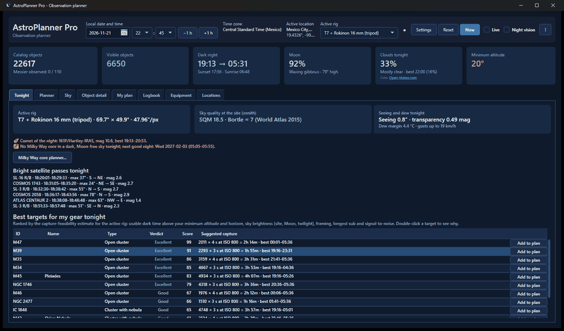
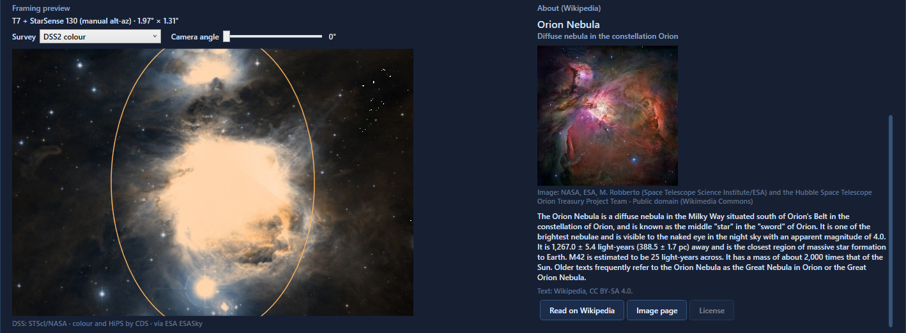
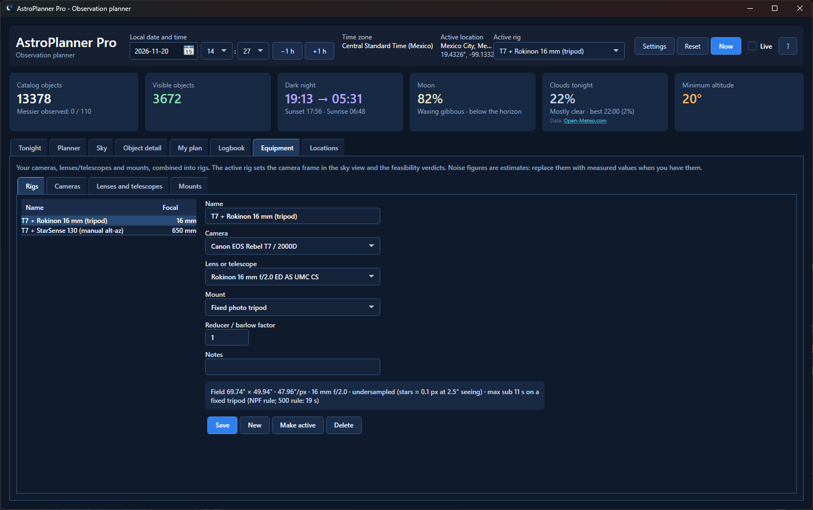
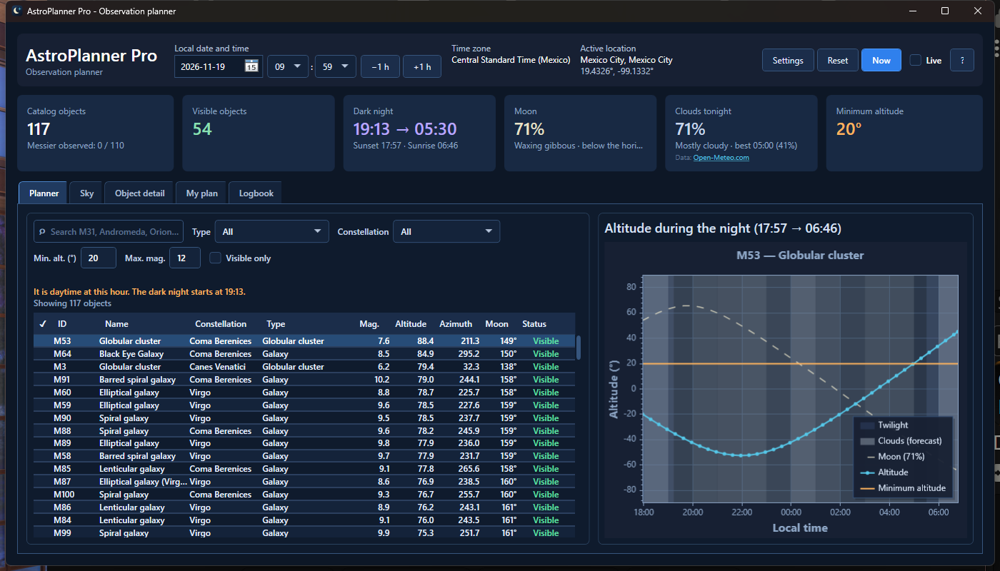
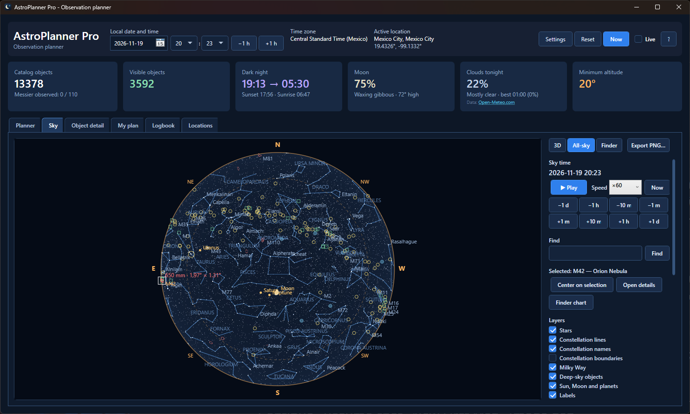
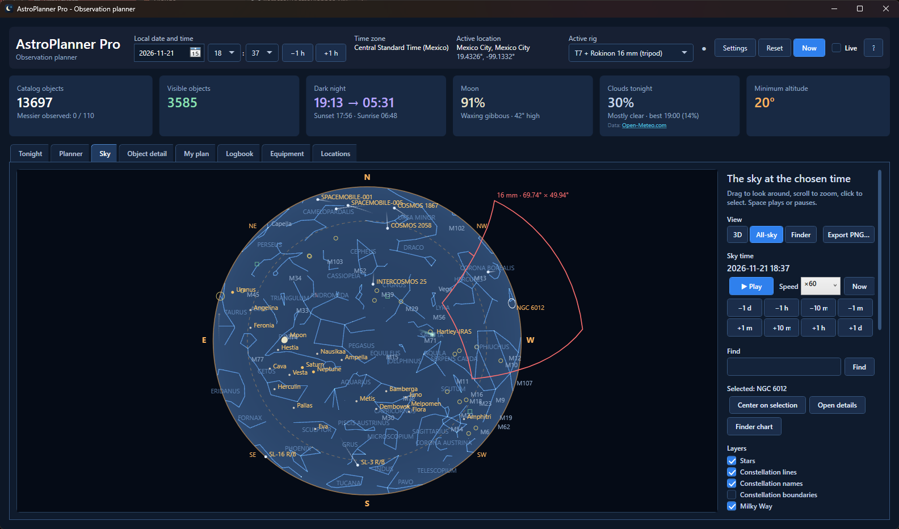
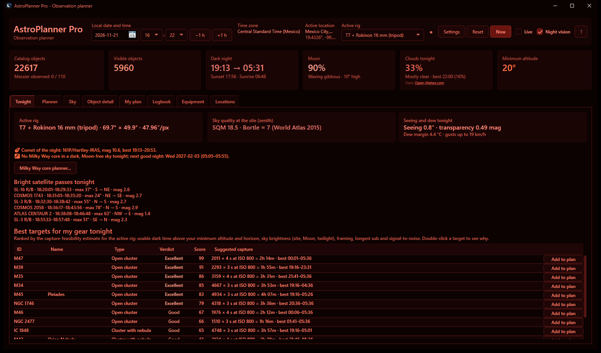
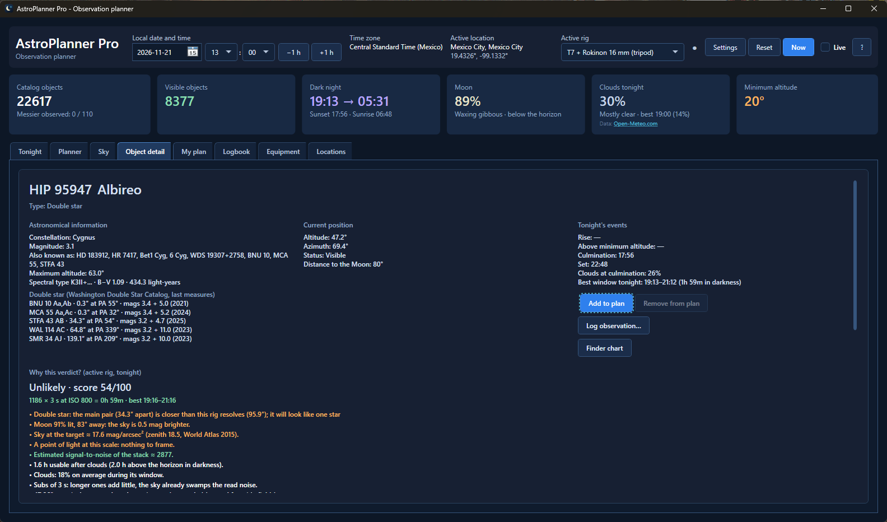
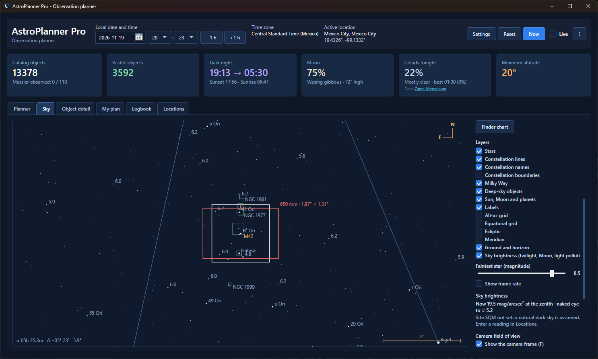

<p align="center">
  
</p>

<h1 align="center">AstroPlanner Pro</h1>

<p align="center">
  <b>What to photograph tonight, when, with which gear — and how likely it is to work.</b><br>
  An astrophotography planner for Windows.
</p>

<p align="center">
  <a href="https://github.com/Yamato6/AstroPlanner-Pro/actions/workflows/ci.yml"></a>
  
  
  <a href="LICENSE"></a>
</p>

> **v2.0.0** — the first release of AstroPlanner Pro, the astrophotography successor of
> [AstroPlanner v1](https://github.com/Yamato6/AstroPlanner) (whose full history it keeps).
> **[Download it](#download-and-install)** · [what's new](CHANGELOG.md) · [architecture](docs/architecture.md)























## What it does

- **What can I photograph tonight, with my gear?** Every object gets an honest, explainable
  estimate for the active rig: a verdict (Excellent → Not possible), a score and the reasons. They
  cover usable dark time above your horizon, sky brightness at the target (light pollution,
  moonlight with Krisciunas & Schaefer, twilight), framing, the longest sub (NPF rule or your mount)
  and the signal-to-noise of the whole stack. The estimate comes with a suggested capture (subs,
  ISO/gain, total time, best window). The *Tonight* tab ranks the best targets. See
  [how it works](docs/feasibility-model.md).
- **Equipment**: cameras, lenses and telescopes, mounts and rigs, with the field of view, image
  scale, sampling and maximum exposure computed live. The active rig drives the verdicts and the
  camera frame on the sky.
- **Light-pollution aware**: the zenith sky quality of any site comes from the World Atlas 2015
  (Falchi et al. 2016), shipped as a compact offline grid (Mexico at 30″, the world at 5′). An SQM
  reading typed for the site takes precedence.
- 🔭 **13,371 deep-sky objects and the 7 planets**: the whole NGC/IC catalog (OpenNGC), with all
  110 Messier and 109 Caldwell objects, sizes, surface brightness, common names and cross-IDs.
  Search by any identifier (`M31`, `NGC 224`, `C14`, `IC 434`, `Sh2-155`, `PGC 2557`) or name, and
  filter by catalog, type, constellation, magnitude, size and visibility, in milliseconds.
- 🌌 **Tonight for every object**: maximum altitude and the best window in astronomical darkness
  above your minimum altitude and your local horizon, computed for the whole catalog in the
  background.
- 🌙 **The real night**: sunset and sunrise, astronomical darkness, Moon phase and a warning when its glare gets in the way.
- ☁️ **Tonight's conditions**: hourly clouds (Open-Meteo), seeing and transparency (7Timer!) and
  warnings for dew (air close to its dew point) and wind (gusts too strong for your mount). The
  forecast seeing and haze refine the verdicts. Forecasts are kept on disk, so offline you see the
  last one, marked with its time.
- 🖼️ **Framing preview**: the object as your camera would frame it, at the rig's exact field and
  aspect, with a camera-angle slider and the object's outline, drawn from DSS2 or Pan-STARRS survey
  tiles (HiPS). Wide lenses use a single all-sky image; tiles are saved for offline use.
- 📖 **About the object**: the Wikipedia introduction and image, with the image's author and
  license, and links to both pages.
- 🔎 **Find anything**: a sky search that finds nothing in the catalog asks CDS Sesame (SIMBAD,
  NED, VizieR), so "Barnard 33" or "Sh2-240" still centres the view.
- ☄️ **Comets and asteroids**: the comets brighter than magnitude 15 tonight and ~300 bright
  asteroids, from the Minor Planet Center's elements, in the table, the sky (comets with a tail
  pointing away from the Sun) and the feasibility verdicts, with a "comet of the night" alert.
  Orbits are computed for any eccentricity and checked against JPL Horizons.
- ⭐ **Stars and double stars**: the ~8,900 naked-eye stars (to magnitude 6.5) are catalog rows
  next to the deep-sky objects, findable by name, Bayer or Flamsteed ("β Cyg", "Beta Cygni",
  "61 Cyg"), HIP or HD number, with their spectral type, colour, distance and variability. The
  ~1,800 bright doubles show their pairs from the Washington Double Star Catalog, and the verdict
  says whether your rig splits them. Clicking a star in the sky selects its row.
- 🌌 **Milky Way core**: the galactic centre as a wide-field target, tonight's window in a dark,
  Moon-free sky (or the next good night), and a 12-month planner with the best nights.
- 🛰️ **Satellites**: the ~160 brightest satellites and the space stations from CelesTrak, moving
  across the live sky with a short trail (dimmed in the Earth's shadow), tonight's visible bright
  passes with an ISS alert, and the sunlit satellites that will cross your camera's field during
  each planned block (on the timeline and in the PDF), so you know which frames may get a trail.
- 🌠 **Live sky**: a GPU-rendered sky dome (three.js in WebView2) with 83k stars, constellations,
  the Milky Way, 13k deep-sky objects and the Sun, Moon (with its phase) and planets, all
  positioned by the same tested astronomy core as the tables. Play time at up to ×3600, step by
  minutes to days, find any object, click to select it and open its details.
- 🗺️ **All-sky and finder charts**: the whole sky as on v1's chart (north up, east left), and a
  finder chart of any object (gnomonic, star magnitudes, scale bar) exported as PNG.
- 📷 **Camera frame**: your sensor and focal length drawn on the sky at its true size; drag it,
  rotate it, it follows the selection.
- 🌆 **Sky brightness**: twilight, moonlight and your site's light pollution (SQM) tint the sky
  and hide the faint stars, so you see how washed-out the night will be.
- 📍 **Saved sites**: home, dark sites… each with its IANA and Windows time zone, a horizon
  profile (trees, buildings) edited by azimuth, and its measured sky brightness (SQM).
- 📋 **Session planner**: your targets scheduled across the night with your gear, each in the
  stretch where it gathers the most signal (Moon, clouds and horizon included). For each one you
  get the start and end, the subs, ISO/gain and total integration, and the meridian flip on
  equatorial mounts. It shows a timeline and lets you set priorities and lock blocks. A checklist
  covers batteries, dew heater, focus and calibration frames. Export it as PDF, CSV or `.ics`, or
  print it.
- 📓 **Logbook**: record what you observe or photograph and track your Messier marathon and Caldwell
  progress (observed and photographed). A photographed entry keeps the rig, subs, ISO/gain, the
  image file and tonight's prediction; *Predictions vs results* compares the model's scores with
  your ratings, and Settings › Advanced lets you recalibrate it.
- 🔴 **Night vision**: a red-on-black theme for the whole app, the charts, the 3D sky and the title
  bar (`Ctrl+Shift+N`), so your eyes stay dark-adapted at the telescope.
- ♿ **Accessible**: every control has a name for screen readers, and the text of both themes
  meets WCAG AA contrast (both checked by the tests).
- ↪️ **Import from AstroPlanner v1**: on first run, your v1 settings, plan and logbook are offered
  for import (the v1 files are only read).
- ⏱️ **Live mode**: follows the clock and refreshes everything every minute.

It works offline; the internet is only used for the forecasts, the survey images, descriptions,
name search, comet and asteroid elements, satellite elements and the new-version notice, each of
which can be turned off.

## Why AstroPlanner Pro

AstroPlanner v1 answers "what can I *see* tonight?". AstroPlanner Pro answers **"what can I
*photograph* tonight, from here, with my equipment — and how should I do it?"**: an equipment
inventory (field of view, image scale, longest sub), an explainable capture-feasibility score per
target, light-pollution-aware sky brightness, a live 2D/3D sky rendered with three.js in WebView2,
survey imagery for framing and a session planner. See the [CHANGELOG](CHANGELOG.md) for the whole
story, milestone by milestone.

## Download and install

Get the latest version from **[Releases](https://github.com/Yamato6/AstroPlanner-Pro/releases/latest)**:

- **`AstroPlannerPro_<version>_Setup.exe`** — the installer. It installs for your user only (no
  administrator rights), adds a Start menu entry and an uninstaller, and updates an earlier
  version in place.
- **`AstroPlannerPro_<version>_win-x64_portable.zip`** — a single `.exe`, no installation; unzip
  it anywhere and run it.
- **`SHA256SUMS.txt`** — check a download with `Get-FileHash <file> -Algorithm SHA256`.

Windows 10 (1809) or 11, x64; .NET is included. The 3D sky uses the Microsoft Edge **WebView2
Runtime**, built into Windows 11; if it is missing, the installer offers to open Microsoft's page
for it, and the app uses its 2D sky charts meanwhile. The release is not code-signed yet, so
SmartScreen may show "Windows protected your PC": choose *More info* → *Run anyway*.

**Coming from AstroPlanner v1?** Both apps install side by side. On its first start AstroPlanner
Pro offers to import v1's settings, plan and logbook (v1's files are only read). Uninstalling
keeps your data in `%LocalAppData%\AstroPlannerPro`.

## Getting started

1. **Settings** → choose your city or enter your coordinates.
2. Choose the date and time, or press **Now**.
3. Select an object to see its curve for the night and, in **Object detail**, add it to **My plan**.

| Shortcut | Action | Shortcut | Action |
|---|---|---|---|
| `Ctrl+F` | Search | `Ctrl+P` | Print the plan |
| `F5` | Current time | `Ctrl+E` | Export the plan to CSV (PDF and `.ics` in the *My plan* tab) |
| `Ctrl+,` | Settings | `F1` | About |
| `Ctrl+Shift+N` | Night vision on/off | | |

In the **Sky** tab (outside a text box): `Space` plays or pauses, `/` finds an object, `1` and `2`
switch between the 3D dome and the all-sky chart, and `F` shows or hides the camera frame.

Your data (settings, sites, plan, logbook) is stored in `%LocalAppData%\AstroPlannerPro\app.db`
(SQLite). AstroPlanner v1's data is only read when you import it, never changed, and both apps
can be installed side by side.

## Privacy

AstroPlanner Pro has no accounts and collects no data. It only connects to:

- **api.open-meteo.com**, for clouds, dew point and wind, sending your location **rounded to
  ~1 km**;
- **www.7timer.info**, for seeing and transparency, also sending your location **rounded to
  ~1 km**;
- **alasky.cds.unistra.fr** and its mirror **skies.esac.esa.int** (ESA ESASky), for the survey
  images of the framing preview, receiving only **sky coordinates** (tile numbers);
- **en.wikipedia.org** and **commons.wikimedia.org**, for descriptions and image licenses,
  receiving the **object's name**;
- **cds.unistra.fr** (or its mirrors vizier.cfa.harvard.edu and vizier.idia.ac.za), only when a
  sky search finds nothing in the catalog, receiving the **name you typed**;
- **minorplanetcenter.net**, for comet (daily) and bright-asteroid (yearly) orbital elements
  (nothing about you is sent);
- **celestrak.org**, for the orbital elements of the bright satellites and space stations, at most
  twice a day and never again for 2 hours after an error (nothing about you is sent);
- **api.github.com**, to check for a new version (nothing about you is sent).

Each one can be turned off in **Settings → Internet connection**, where the saved answers (kept in
`%LocalAppData%\AstroPlannerPro\cache` for offline use) can be cleared. The dot in the top bar
shows whether the services are online, offline (showing saved data) or off.

## For developers

```bash
dotnet build AstroPlanner.slnx -warnaserror
dotnet run --project src/AstroPlanner.UI
dotnet test AstroPlanner.slnx          # ~850 .NET tests, no network
cd src/sky-renderer && npm ci && npm test   # renderer: ~150 Vitest tests, most generated from the bridge and projection fixtures (the UI build runs npm itself)
dotnet run --project tools/AstroPlanner.DataBuilder -- all   # rebuild the catalogs (downloads the sources)
```

Requires the .NET 10 SDK and Node.js 22.12+ (the UI build compiles the sky renderer; see
[docs/sky-renderer.md](docs/sky-renderer.md)). Every push runs CI (build with warnings as errors, tests, coverage with an
85 % line-coverage gate on Core, a check of the committed catalog database); a `v*` tag publishes the `.exe`, the installer and the checksums to a
draft release whose notes come from this CHANGELOG ([docs/signing.md](docs/signing.md) explains the optional
code signing). Start with [CONTRIBUTING.md](CONTRIBUTING.md) and [docs/architecture.md](docs/architecture.md),
and every online service is listed in [docs/external-services.md](docs/external-services.md).
Security issues: see [SECURITY.md](SECURITY.md).

<details>
<summary><b>Architecture</b></summary>

Clean architecture + strict MVVM. `AstroPlanner.Core` knows nothing about IO, HTTP or the UI; the
rules are enforced by architecture tests.

```
src/
  AstroPlanner.Core/     Pure domain, BCL only
    Algorithms/            Meeus (precession, Sun, Moon, planets), event finder, IAU constellations,
                           refraction, air mass, orbits, sky frame
    Imaging/               optics, exposure limits, framing preview;
                           Feasibility/ (capture model, tuning, predictions vs results)
    Planning/              night ephemerides, sky samples, session scheduler, Milky Way planner
    Satellites/            own near-Earth SGP4, element sets, passes, Earth shadow, field crossings, tracks
    Sky/                   star names, HEALPix, galactic centre, moving bodies, sky appearance
    SkyQuality/            sky brightness and background, Krisciunas–Schaefer moonlight
    Weather/               night conditions (seeing, transparency, dew, wind)
    Models/ Interfaces/ Services/   records, persistence contracts, AstronomyService
  AstroPlanner.Data/     SQLite: embedded catalogs.sqlite, app.db (migrations, settings, sites, plan,
                         logbook, equipment), disk cache of online answers, light-pollution grids,
                         v1 importer, cities                                           → Core
  AstroPlanner.Online/   One client per service, all through Http/CachedFetch          → Core
                         Weather: Open-Meteo, 7Timer! · Imaging: HiPS survey tiles (CDS, ESA ESASky)
                         Info: Wikipedia/Commons, CDS Sesame · SmallBodies: MPC · Satellites: CelesTrak
                         (the GitHub releases check lives in UI/Services/UpdateChecker)
  AstroPlanner.SkyBridge/ WPF ⇄ WebView2 protocol: DTOs, validating codec              → Core
  sky-renderer/          TypeScript + three.js sky (WebView2); draws only, astronomy comes from Core
  AstroPlanner.UI/       WPF app and composition root
    ViewModels/            Shell, Tonight, Targets, Sky, ObjectDetail, SessionPlan, Logbook, Locations,
                           Settings, Equipment, Framing, ObjectInfo, MilkyWayPlanner
    Services/              shared state (IObserverContext, WeatherState, EquipmentState, SmallBodyState,
                           SatelliteState, OnlineInfoState, ThemeState), named HttpClients, exports
                           (CSV, PDF, .ics, print), logging, update checker, safe links, single instance
    Sky/                   WebView2 host of the renderer, its clock and assets
    Resources/Strings.resx All user-facing text (localisable)
    Themes/                Dark.xaml (palette and styles, also used by the charts), Night.xaml (red colors)
tools/
  AstroPlanner.DataBuilder    Builds data/build/catalogs.sqlite and the sky data (docs/data-pipeline.md)
data/                     SOURCES.md, curated/ overlays, build/ generated files (raw/ is git-ignored)
tests/
  AstroPlanner.Core.Tests     Meeus worked examples, JPL Horizons fixtures, Roman (1987) test positions
  AstroPlanner.Data.Tests     Catalog database, app.db, migrations, v1 import
  AstroPlanner.DataBuilder.Tests  Catalog build from small excerpts of the sources
  AstroPlanner.Online.Tests   HTTP clients with stubbed responses
  AstroPlanner.SkyBridge.Tests  Protocol contract and projection cross-check (shared with Vitest)
  AstroPlanner.UI.Tests       View models, services, windows (accessibility, contrast) and architecture rules
installer/                Inno Setup script
.github/workflows/        CI and releases
```

</details>

<details>
<summary><b>Design decisions</b></summary>

**Astronomy**
- **Observing night:** from sunset to sunrise (Sun's center at −0.833°); the dark night with the Sun
  below −18°. 02:00 belongs to the night that started the day before. Where the Sun does not set,
  18:00 → 06:00 is used.
- **Event times:** bracketed every 10 minutes in UTC, then refined by bisection (rise, set,
  thresholds, twilight) and golden-section search (culmination) to about a second. Checked
  against JPL Horizons: sunset, sunrise and twilight in Aguascalientes, Madrid and Oslo, and
  Jupiter and Saturn rise, culmination and set, all **within one minute**.
- **Night ephemerides of the catalog:** fixed objects are precessed once per night and sampled
  every 5 minutes with a shared sidereal time (transit solved analytically); planets go through
  the full model. The ~22,600 catalog rows take well under a second, in the background (the
  performance test uses 25k objects and a 1 s budget).
- **Constellations:** the IAU boundaries (Roman 1987, CDS VI/42) after precessing to B1875; they
  agree with OpenNGC for all 13,371 objects. Planets get their real constellation for the date.
- **Air mass and extinction:** Kasten & Young (1989) and Δm = k·X with k = 0.25 mag (used by the
  feasibility model from M3).
- **Precision:** precession J2000 → date (~0.36° in 2026) and refraction (~34′ at the horizon at sea
  level). No nutation or aberration (< 30″); UT instead of TT (ΔT ≈ 70 s). The site's elevation
  scales the refraction by the standard-atmosphere pressure there (`Refraction.PressureScale`, in
  every altitude the app computes and in the 3D sky), and places the observer on the WGS-84
  ellipsoid for satellite passes.
- **Moon:** low-precision Astronomical Almanac formulae (~0.3°) with parallax and refraction. It
  interferes when above the horizon, ≥ 25 % lit and less than 30° from the object.
- **Planets:** JPL Keplerian elements (1800-2050) with light-time correction; ~1′ error for the inner
  planets and up to ~10′ for Jupiter and Saturn. Meeus magnitudes (ch. 41) including Saturn's rings (ch. 45).
- **Comets and asteroids:** two-body orbits from the MPC osculating elements, elliptic, parabolic
  and hyperbolic (safeguarded Newton; Barker's equation), with light time. Against JPL Horizons over
  a month around the elements' epoch: 4–17″ for 2P/Encke, C/2023 A3 and C/2025 A6, 4″ for Vesta;
  a year after the epoch of the yearly asteroid file, Vesta is off by 44″. Magnitudes: the MPC's
  comet formula (H + 5 log Δ + 2.5 K log r) and the IAU H-G system for asteroids.
- **Milky Way core:** Sgr A* as a fixed target; a night counts as good with at least 30 minutes of
  the core above 10° in astronomical darkness with the Moon down.
- **Satellites:** our own SGP4 (near-Earth orbits, Vallado et al. 2006, WGS-72) rather than a
  library, because `AstroPlanner.Core` depends on nothing but the .NET base class library. It reproduces
  the paper's verification set to under a metre; CelesTrak GP elements in OMM form. Against JPL
  Horizons' own ISS trajectory a few hours after the elements' epoch: altitude within 0.6°, rise
  and set at 10° within 30 s. A pass is visible while the satellite is sunlit (conical Earth shadow)
  and the Sun is at least 6° below the horizon. Magnitudes from McCants' intrinsic magnitudes
  (1000 km, full phase) with range and phase; satellites without one show no magnitude.
- **Wall-clock time → UTC:** sites store both the IANA and the Windows time zone id and convert
  with `TimeZoneInfo`; times skipped by daylight saving time move forward one hour.

**Application**
- **Filtering never recalculates:** search and filters only filter; positions are recalculated only
  when the time, the location or the minimum altitude change.
- **Shared state through services:** view models read `IObserverContext` and `WeatherState` instead of
  referencing each other.
- **Live mode with `TimeProvider`:** tests use a manual clock; the timer goes back to the UI thread
  through the captured `SynchronizationContext`.
- **Invalid input:** `ObservableValidator` with `[Range]`; an out-of-range value shows a warning and
  the last valid calculation is kept.
- **Catalog:** `catalogs.sqlite` is built by a deterministic tool, embedded in the `.exe`, copied
  once to the data folder and loaded into memory; search keys are precomputed, so filtering the
  ~22,600 rows takes milliseconds and never recalculates positions.
- **Data:** SQLite `app.db` in `%LocalAppData%\AstroPlannerPro`, with versioned migrations applied
  in a transaction after a backup copy. A damaged file is set aside as `app.corrupt-<date>.db`
  instead of being overwritten.
- **Errors:** unhandled exceptions are logged in `logs\` and reported without closing the app.
- **Single instance:** opening it twice brings the existing window to the front, so two processes never
  write the plan at the same time.
- **Optional internet:** one named `HttpClient` per service with the standard pipeline of
  `Microsoft.Extensions.Http.Resilience`: 15 s in total, 6 s per attempt, two retries with backoff
  and a circuit breaker. CelesTrak has its own client without retries (it blocks clients that
  repeat failing requests) and the service pauses 2 h after an error. Every answer goes through
  a disk cache (`%LocalAppData%\AstroPlannerPro\cache`, 200 MB, least recently used entries
  removed first): a fresh entry avoids the request and a failure falls back to the last one. Ages:
  Open-Meteo 1 h, 7Timer! 3 h, CelesTrak 12 h, MPC comets 24 h and asteroids 30 days, Wikipedia and
  Sesame 30 days, survey tiles kept. After a failure the app waits 5 min before asking again for
  forecasts, comets and asteroids, and 15 min for satellites; a failing survey mirror is skipped for
  10 min. See [docs/external-services.md](docs/external-services.md). Pre-releases are only offered
  to users of a pre-release or a 0.x version.
- **Links:** only `https` addresses of these sites (and their subdomains) are opened: github.com,
  open-meteo.com, 7timer.info, wikipedia.org, wikimedia.org, creativecommons.org, cds.unistra.fr,
  esa.int, stsci.edu, minorplanetcenter.net and celestrak.org.
- **CSV:** separator and numbers follow the system culture, UTF-8 with BOM, so that Excel opens it right.

**Build**
- **.NET 10 LTS**, C# 14, warnings as errors and `AnalysisLevel=latest-recommended` everywhere;
  package versions pinned in `Directory.Packages.props`.
- **One self-contained, compressed `.exe`** (~82 MB instead of ~179 MB uncompressed; the v2.0.0
  release's is 81.6 MB), ~0.2 s slower to start. The catalogs and the sky renderer are embedded.
- **NU1701 suppressed:** caused by `SkiaSharp.Views.WPF` (a ScottPlot dependency), which only declares
  .NET Framework but works on modern .NET.

</details>

<details>
<summary><b>Dependencies</b></summary>

| Project | Package | Version |
|---|---|---|
| Data, DataBuilder | Microsoft.Data.Sqlite | 11.0.0 |
| UI | CommunityToolkit.Mvvm | 8.4.2 |
| UI | Microsoft.Extensions.DependencyInjection | 11.0.0 |
| UI | Microsoft.Extensions.Http · Microsoft.Extensions.Http.Resilience (named clients, retries, circuit breaker) | 11.0.0 · 11.0.0 |
| UI | Microsoft.Web.WebView2 (hosts the 3D sky) | 1.0.4314.35 |
| UI | PDFsharp (PDF export) — pinned to 6.2.x: 6.5.0 and later are AGPL-3.0, the app is MIT | 6.2.4 |
| UI | System.Security.Cryptography.Pkcs — PDFsharp 6.2.4 pulls 8.0.1, which has known vulnerabilities (GHSA-2fmv-rv2c-59x7, GHSA-846f-f764-76mx) | 11.0.0 |
| UI | ScottPlot.WPF | 5.1.59 |
| sky-renderer (npm) | three · zod | 0.187.0 · 4.6.7 |
| Tests | xunit · xunit.runner.visualstudio | 2.9.3 · 4.0.1 |
| Tests | FluentAssertions | 8.11.0 |
| Tests | Microsoft.NET.Test.Sdk · coverlet.collector | 18.12.0 · 10.1.1 |

</details>

## Credits and license

- Deep-sky catalog: [OpenNGC](https://github.com/mattiaverga/OpenNGC) by Mattia Verga
  ([CC BY-SA 4.0](https://creativecommons.org/licenses/by-sa/4.0/)).
- Stars: [HYG database](https://codeberg.org/astronexus/hyg) v4.4 by David Nash / astronexus.net (CC BY-SA 4.0).
- Double stars: [Washington Double Star Catalog](http://www.astro.gsu.edu/wds/), U.S. Naval Observatory (public domain).
- Constellation boundaries: Roman (1987), CDS VI/42, as distributed with
  [astropy](https://github.com/astropy/astropy) (BSD-3-Clause).
- Light pollution: grids derived from the World Atlas 2015 of artificial night sky brightness, Falchi et al. (2016),
  *Science Advances* 2, e1600377; data: GFZ Data Services, [doi:10.5880/GFZ.1.4.2016.001](https://doi.org/10.5880/GFZ.1.4.2016.001)
  ([CC BY-NC 4.0](https://creativecommons.org/licenses/by-nc/4.0/)).
- Moonlight: Krisciunas & Schaefer (1991), *PASP* 103, 1033.
- Cloud forecast: [Open-Meteo.com](https://open-meteo.com/) (data under [CC BY 4.0](https://creativecommons.org/licenses/by/4.0/)).
- Algorithms: Jean Meeus, *Astronomical Algorithms* (2nd ed.), and approximate orbital elements from JPL (NASA).
- Charts: [ScottPlot](https://scottplot.net/).
- Based on [AstroPlanner](https://github.com/Yamato6/AstroPlanner) v1.0.0 by the same author.

Sources, versions and checksums: [data/SOURCES.md](data/SOURCES.md); license texts:
[THIRD_PARTY_NOTICES.md](THIRD_PARTY_NOTICES.md). The code is MIT; the catalogs keep their own
licenses. **AstroPlanner Pro is and will stay free:** the light-pollution atlas it uses
(Falchi et al. 2016) is licensed for non-commercial use only.

© 2026 Yamato6 · [MIT License](LICENSE)
