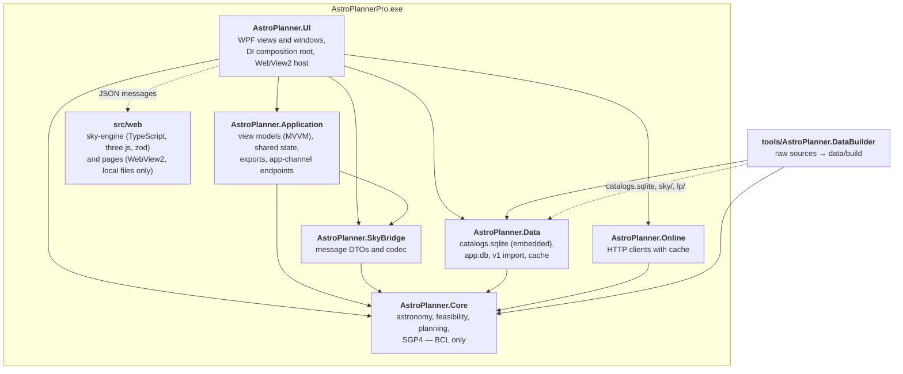

# Architecture

AstroPlanner Pro is a WPF desktop app (C# 14, .NET 10) with a TypeScript/three.js sky renderer
hosted in WebView2. The rules below are enforced by
`tests/AstroPlanner.UI.Tests/ArchitectureTests.cs`.

## Layers

| Project | Responsibility | May reference |
|---|---|---|
| `AstroPlanner.Core` | All astronomy (positions, events, refraction, constellations, moving bodies, SGP4), sky quality, the capture-feasibility model, the session scheduler, the logbook statistics. Pure functions over immutable records. | BCL only |
| `AstroPlanner.Data` | SQLite: the embedded read-only `catalogs.sqlite`, the user's `app.db` (migrations in `Storage/Migrations`), the disk cache, the light-pollution grids, the v1 importer. | Core |
| `AstroPlanner.Online` | One client per external service ([external-services.md](external-services.md)), all through `CachedFetch`. | Core |
| `AstroPlanner.SkyBridge` | The WPF ⇄ web protocols ([bridge.md](bridge.md)): the sky protocol (payload records, JSON codec, camera matrix) and the app channel of the v3 UI (contracts, codec, `RpcDispatcher`). No WPF. | Core |
| `src/web` | npm workspace. `packages/sky-engine` draws what C# sends: it applies the `SkyFrame` matrix and interpolates body tracks sampled by Core; it computes no astronomy. `apps/planetarium` holds the pages: the v2 Sky tab and the v3 UI in development (`--ui=web`, [ui.md](ui.md)), whose components and tokens are in `packages/ui-kit` ([sky-renderer.md](sky-renderer.md)). | — |
| `AstroPlanner.Application` | The view models and shared state services (MVVM, no WPF), exports (CSV, PDF, `.ics`), the UI strings (`Resources/Strings.resx`) and the app-channel endpoint modules of the web UI (`Bridge/`). Shared by the WPF window and the web UI. | Core, SkyBridge |
| `AstroPlanner.UI` | WPF views, windows, charts and themes; the WebView2 host; the composition root; what needs WPF or the exe (image decoding, printing, window placement, the exe's version, the v1 import, named `HttpClient`s, logging to disk). | all of the above |
| `tools/AstroPlanner.DataBuilder` | Downloads and verifies the sources ([data-pipeline.md](data-pipeline.md)). Nothing in the app references it. | Core, Data |
| `tools/AstroPlanner.BridgeGen` | Writes the TypeScript contracts of the app channel from the C# records ([bridge.md](bridge.md)). Only its test references it. | SkyBridge |

## Inside the UI and Application

- **Composition root** (UI): `App.xaml.cs` registers every service and view model as a singleton.
- **Shared state** goes through injected services, never through one view model reaching into
  another: `IObserverContext` (site, time, minimum altitude, horizon, night, Moon, sky quality,
  darkness, calibration; raises `Recalculated`), `WeatherState`, `EquipmentState`,
  `OnlineInfoState`, `SmallBodyState`, `SatelliteState` and `ThemeState`.
- **View models**: `ShellViewModel` owns Tonight, Targets, Sky, Detail, Plan, Logbook, Locations,
  Settings and Equipment. Long work (night ephemerides, feasibility for the whole catalog,
  satellite passes) runs in the background, keyed by its inputs, and exposes a `Task` the tests
  await. A large view model is split into parts it owns: `SkyViewModel` coordinates `Sky.Time`
  (clock), `Sky.Layers`, `Sky.Camera` (camera frame), `Sky.Search`, `Sky.Modes` (dome, all-sky,
  finder chart) and `Sky.Map` (2D fallback), with `SkySession` (renderer channel, settings, clock)
  and `SkyBodyFeed` (frame, tracks, appearance) inside. Parts get delegates from their owner,
  never references to other view models.
- **The sky's images** (R2c): `data/` next to the exe (panorama, landscapes, `manifest.json`),
  read by `Application/Services/MediaLibrary` and served to WebView2 as `https://media.astroplanner/`
  (`SkyHosts.MediaHost`) only when the folder exists. It is a third host beside `app.astroplanner`
  (the pages) and `data.astroplanner` (the sky data extracted from the exe), not part of the data
  host: those images are files of the installation, read-only, that the app can run without, while
  the data host's folder is rebuilt from the exe at every update. Spec §5.4 names one data host;
  this is a deliberate deviation.
- **Views** are thin: code-behind only opens dialogs, moves the focus and switches tabs, and asks
  `Charts/*` (`SkyMapChart`, `AltitudeChart`, `PlanTimelineChart`, `HorizonChart`,
  `PredictionChart`, colors from `ChartPalette`) to redraw. Commands without a dialog are
  `KeyBinding`s. Strings come from `Resources/Strings.resx`; colors from `Themes/Dark.xaml` /
  `Themes/Night.xaml` through `DynamicResource`.
- **One thread**: view models and state services are not thread-safe. Like WPF objects they are
  used on the UI thread; background work comes back to it (`await` on the UI context, or
  `IUiDispatcher` in `Application/Bridge`). The view-model tests run xUnit with
  `maxParallelThreads: 1` so that their continuations are serialized the same way.

## Data flow of one evening

1. The user picks a site and a time → `ObserverContext` computes the night, the Moon and the sky
   quality and raises `Recalculated`.
2. `TargetsViewModel` computes each object's night ephemeris and, with the active rig and the
   forecast, its feasibility report (`FeasibilityCalculator.EvaluateAll`) in the background.
3. Tonight ranks the best targets; *My plan* schedules the chosen ones (`SessionScheduler`).
4. The sky gets the site, time, frame matrix, highlights and body tracks through the bridge.
5. After the session the user logs what was photographed; the logbook compares the model's
   predictions with the results.

## Persistence

| Store | Where | Contents |
|---|---|---|
| `catalogs-<hash>.sqlite` | `%LocalAppData%\AstroPlannerPro\catalogs` (extracted from the exe) | NGC/IC, Messier, Caldwell, HYG stars, WDS doubles (read-only) |
| `app.db` | `%LocalAppData%\AstroPlannerPro` | settings (JSON), locations, plan, logbook, equipment, sky view; backed up before each migration |
| `cache/` | same | online answers, for offline use |
| `logs/` | same | one log file per day |

AstroPlanner v1's `%LocalAppData%\AstroPlanner` is only ever read, by the importer.

## Testing

One test project per layer (`tests/AstroPlanner.*.Tests`), no network: HTTP goes through
`StubHttpHandler` and recorded fixtures, astronomy is checked against JPL Horizons and Meeus,
and the bridge against golden files. UI tests build the view-model graph with `TestShell.Create`
(`LoadAndSettleAsync` loads it and waits for the ephemerides and feasibility);
`AccessibilityTests` also builds the real windows on an STA thread. Core has an 85 % line-coverage
gate in CI, Application 80 %.

- Shared helpers: `tests/Shared` (linked into the projects that need them), `OnlineTestKit.cs` in
  Online.Tests (recorded answers, an in-memory cache), `Fixtures` in DataBuilder.Tests.
- Timing budgets carry `[Trait("Category", "Performance")]` and run apart from coverage.
- Tests of the WPF views carry `[Trait("Retires", "R5")]` (`MainWindowLogicTests`,
  `SkyBindingTests`, `AccessibilityTests`): R5 deletes those views, and their tests go or move
  with them (`dotnet test --filter Retires=R5` lists them).
- CI (`.github/workflows/ci.yml`): the jobs `web` (lint, build, Vitest, Playwright) and `dotnet`
  (build without the web pages, DataBuilder `verify`, performance tests, tests with coverage and
  its gates; NuGet packages cached) run side by side, and `test`, the check `main` requires,
  passes only when both did. The release job builds the exe with the pages and requires them.
