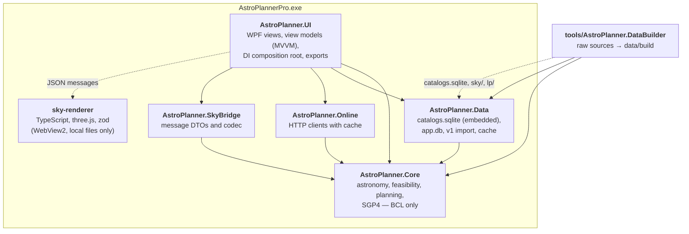

# Architecture

AstroPlanner Pro is a WPF desktop app (C# 14, .NET 10) with a TypeScript/three.js sky renderer
hosted in WebView2. The rules below are enforced by
`tests/AstroPlanner.UI.Tests/ArchitectureTests.cs`.

## Layers

| Project | Responsibility | May reference |
|---|---|---|
| `AstroPlanner.Core` | All astronomy (positions, events, refraction, constellations, moving bodies, SGP4), sky quality, the capture-feasibility model, the session scheduler, the logbook statistics. Pure functions over immutable records. | BCL only |
| `AstroPlanner.Data` | SQLite: the embedded read-only `catalogs.sqlite`, the user's `app.db` (migrations in `Storage/Migrations`), the disk cache, the light-pollution grids, the v1 importer. | Core |
| `AstroPlanner.Online` | One client per external service ([external-services.md](external-services.md)), all through `CachedFetch`. | Core |
| `AstroPlanner.SkyBridge` | The WPF ⇄ renderer protocol: payload records, the JSON codec, the camera matrix. No WPF. | Core |
| `sky-renderer` | Draws what C# sends: it applies the `SkyFrame` matrix and interpolates body tracks sampled by Core; it computes no astronomy ([sky-renderer.md](sky-renderer.md)). | — |
| `AstroPlanner.UI` | Views, view models, shared state services, exports (CSV, PDF, `.ics`), themes. | all of the above |
| `tools/AstroPlanner.DataBuilder` | Downloads and verifies the sources ([data-pipeline.md](data-pipeline.md)). Nothing in the app references it. | Core, Data |

## Inside the UI

- **Composition root**: `App.xaml.cs` registers every service and view model as a singleton.
- **Shared state** goes through injected services, never through one view model reaching into
  another: `IObserverContext` (site, time, minimum altitude, horizon, night, Moon, sky quality,
  darkness, calibration; raises `Recalculated`), `WeatherState`, `EquipmentState`,
  `OnlineInfoState`, `SmallBodyState`, `SatelliteState` and `ThemeState`.
- **View models**: `ShellViewModel` owns Tonight, Targets, Sky, Detail, Plan, Logbook, Locations,
  Settings and Equipment. Long work (night ephemerides, feasibility for the whole catalog,
  satellite passes) runs in the background, keyed by its inputs, and exposes a `Task` the tests
  await.
- **Views** are thin: code-behind only draws the ScottPlot charts and opens dialogs. Strings come
  from `Resources/Strings.resx`; colors from `Themes/Dark.xaml` / `Themes/Night.xaml` through
  `DynamicResource`.

## Data flow of one evening

1. The user picks a site and a time → `ObserverContext` computes the night, the Moon and the sky
   quality and raises `Recalculated`.
2. `TargetsViewModel` computes each object's night ephemeris and, with the active rig and the
   forecast, its feasibility report (`FeasibilityCalculator.EvaluateAll`) in the background.
3. Tonight ranks the best targets; *My plan* schedules the chosen ones (`SessionScheduler`).
4. The sky gets the site, time, frame matrix, highlights and body tracks through the bridge.
5. After the session the user logs what was photographed; the logbook compares the model's
   predictions with the results.

## Persistence

| Store | Where | Contents |
|---|---|---|
| `catalogs-<hash>.sqlite` | `%LocalAppData%\AstroPlannerPro\catalogs` (extracted from the exe) | NGC/IC, Messier, Caldwell, HYG stars, WDS doubles (read-only) |
| `app.db` | `%LocalAppData%\AstroPlannerPro` | settings (JSON), locations, plan, logbook, equipment, sky view; backed up before each migration |
| `cache/` | same | online answers, for offline use |
| `logs/` | same | one log file per day |

AstroPlanner v1's `%LocalAppData%\AstroPlanner` is only ever read, by the importer.

## Testing

One test project per layer (`tests/AstroPlanner.*.Tests`), no network: HTTP goes through
`StubHttpHandler` and recorded fixtures, astronomy is checked against JPL Horizons and Meeus,
and the bridge against golden files. UI tests build the view-model graph with `TestShell.Create`;
`AccessibilityTests` also builds the real windows on an STA thread. Core has an 85 % line-coverage
gate in CI.
